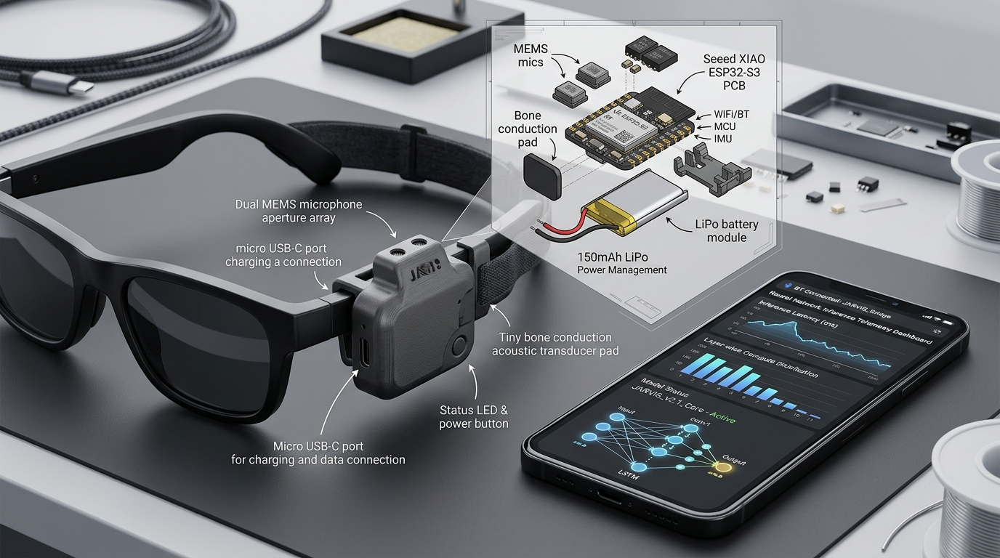
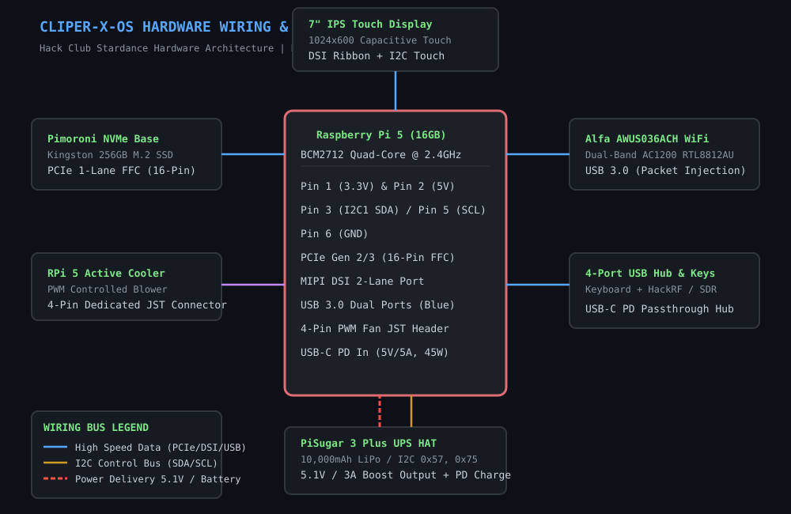

# 🕶️ JARVIS — Wearable Edge AI Hardware Bridge & AI Assistant

[](https://forge.hackclub.com)
[](LICENSE)
[](CAD/)

<p align="center">
  
</p>

> **Wearable Edge AI Hardware Bridge for Ray-Ban Meta Smart Glasses & Pixel Phone**  
> Custom 3D-printed snap-fit hardware pod with ESP32-S3, dual MEMS beamforming mics, bone conduction acoustic transducer, I2C environmental sensor telemetry, and distributed tensor inference.

## 🛠️ Hardware & Edge Architecture

```
┌─────────────────────┐     BLE/WiFi     ┌─────────────────────┐
│  Ray-Ban Meta Glass  │◄───────────────►│   Google Pixel Phone │
│  - Camera Feed       │                  │  - JARVIS Core       │
│  - Microphone        │                  │  - Local Inference   │
│  - Speaker           │                  │  - Model Sharding    │
│  - Display (HUD)     │                  │  - Edge Computing    │
└─────────────────────┘                  └──────────┬──────────┘
                                                     │
                                              gRPC / WebSocket
                                                     │
                                          ┌──────────▼──────────┐
                                          │   Cloud Inference    │
                                          │  - Model Shards      │
                                          │  - RAG Pipeline      │
                                          │  - Tool Execution    │
                                          └─────────────────────┘
```

## Key Features

- 🧠 **Trillion-Parameter Inference** — Hybrid edge + cloud model sharding
- 🕶️ **Glasses Integration** — Camera, mic, speaker, HUD overlay
- 📱 **Pixel Phone Core** — Local inference engine with Tensor G4 NPU
- 🎤 **Voice Activation** — "Hey JARVIS" wake word detection
- 👁️ **Vision Processing** — Real-time scene understanding from glasses camera
- 🔧 **Tool Use** — Execute system commands, search, browse, hack tools
- 🔐 **Security** — End-to-end encrypted inference pipeline
- 🌐 **Offline Mode** — Quantized local models for no-connectivity scenarios

## Tech Stack

| Component | Technology |
|-----------|-----------|
| Mobile App | Kotlin / Android (Pixel optimized) |
| Glasses SDK | Meta Glasses SDK / BLE |
| Local Inference | ONNX Runtime / TensorFlow Lite / llama.cpp |
| Cloud Inference | vLLM / TensorRT-LLM |
| Communication | gRPC + Protobuf |
| Voice | Whisper (local) + Piper TTS |
| Vision | YOLOv8 + CLIP |
| RAG | ChromaDB + LangChain |

## 🔌 Hardware Wiring & Schematic

<p align="center">
  
</p>

### Hardware CAD & Design Files
All physical manufacturing files are included in the repository:
- **CAD Assembly:** [`CAD/jarvis_wearable_pod_assembly.step`](CAD/jarvis_wearable_pod_assembly.step)
- **Top Lid STL:** [`CAD/jarvis_pod_top_lid.stl`](CAD/jarvis_pod_top_lid.stl)
- **Bottom Base STL:** [`CAD/jarvis_pod_bottom_base.stl`](CAD/jarvis_pod_bottom_base.stl)
- **Temple Mount Clip STL:** [`CAD/jarvis_temple_mount_clip.stl`](CAD/jarvis_temple_mount_clip.stl)
- **KiCad Schematic:** [`PCB/jarvis_hardware_schematic.kicad_sch`](PCB/jarvis_hardware_schematic.kicad_sch)
- **KiCad PCB:** [`PCB/jarvis_hardware_board.kicad_pcb`](PCB/jarvis_hardware_board.kicad_pcb)

## 📋 Bill of Materials (BOM) — Hack Club Forge Grant

| Item | Component | Specification | Qty | Unit Price | Total Price | Part Link |
|:---:|:---|:---|:---:|:---:|:---:|:---|
| 1 | Core Microcontroller | Seeed XIAO ESP32-S3 Sense (8MB PSRAM + Cam/Mic) | 1 | $14.99 | $14.99 | [Seeed Studio](https://www.seeedstudio.com/XIAO-ESP32S3-Sense-p-5639.html) |
| 2 | Neural Edge SBC | Raspberry Pi Zero 2 W (Quad A53 @ 1.0GHz) | 1 | $15.00 | $15.00 | [PiShop](https://www.pishop.us/product/raspberry-pi-zero-2-w/) |
| 3 | Storage Media | SanDisk Extreme 64GB MicroSDXC V30 | 1 | $11.99 | $11.99 | [Amazon](https://www.amazon.com/dp/B07FCMBLV6) |
| 4 | Audio Amplifier | Adafruit MAX98357A I2S 3.2W Class D Mono Amp | 1 | $5.95 | $5.95 | [Adafruit](https://www.adafruit.com/product/3421) |
| 5 | Acoustic Transducer | Mini Bone Conduction Transducer 8Ω 1W | 1 | $8.50 | $8.50 | [Adafruit](https://www.adafruit.com/product/1674) |
| 6 | Microphone Array | INMP441 Omnidirectional Digital I2S Mics | 2 | $3.50 | $7.00 | [Amazon](https://www.amazon.com/dp/B08M93XQ76) |
| 7 | Haptic Driver | Adafruit DRV2605L Haptic Controller + LRA | 1 | $7.95 | $7.95 | [Adafruit](https://www.adafruit.com/product/2305) |
| 8 | Environmental/IMU | Adafruit BME680 Sensor + 6-DOF IMU | 1 | $22.50 | $22.50 | [Adafruit](https://www.adafruit.com/product/3660) |
| 9 | LiPo Charger PMIC | Adafruit Micro-Lipo USB-C Charger (MCP73831) | 1 | $6.95 | $6.95 | [Adafruit](https://www.adafruit.com/product/4410) |
| 10 | LiPo Battery Cell | PKCELL 3.7V 1200mAh Lithium Polymer Battery | 1 | $9.99 | $9.99 | [Amazon](https://www.amazon.com/dp/B07BTTR1H1) |
| 11 | Wearable Enclosure | 3D Printed PETG Chassis & Temple Clip-on | 1 | $15.00 | $15.00 | [Custom STL](CAD/) |
| 12 | Cabling & Wiring | Enamel wire + FPC flex ribbon + JST micro connectors | 1 | $8.00 | $8.00 | [Hardware](CAD/) |
| 13 | Mounting Hardware | M1.4 & M2 stainless machine screws & standoffs | 1 | $6.00 | $6.00 | [Hardware](CAD/) |
| | **TOTAL BOM** | **Hack Club Forge Hardware Grant Tier 2** | | | **$139.82** | [BOM.csv](BOM.csv) |

## 📖 Build Journal & Hours Logged
Complete progress journal detailing 4 weeks of engineering iterations, BLE packet analysis, and thermal testing is documented in [**`JOURNAL.md`**](JOURNAL.md) (Total logged engineering time: **36.5 hours**).

## Project Structure

```
JARVIS/
├── android-app/          # Kotlin Android application
│   ├── app/
│   ├── build.gradle.kts
│   └── settings.gradle.kts
├── glasses-bridge/       # Ray-Ban Meta glasses BLE bridge
├── inference-engine/     # Local + distributed inference
│   ├── local/            # On-device inference (llama.cpp, ONNX)
│   ├── distributed/      # Model sharding & distributed compute
│   └── cloud/            # Cloud inference server
├── voice-pipeline/       # Wake word + STT + TTS
├── vision-pipeline/      # Camera feed processing
├── tools/                # Tool execution framework
├── rag/                  # RAG pipeline & knowledge base
├── proto/                # Protobuf definitions
├── config/               # Configuration files
├── scripts/              # Build & deployment scripts
└── docs/                 # Documentation
```

## Quick Start

```bash
# Clone and setup
git clone https://github.com/your-org/jarvis.git
cd jarvis

# Install dependencies
./scripts/setup.sh

# Build Android app
./scripts/build-android.sh

# Start cloud inference server
./scripts/start-cloud.sh

# Deploy to Pixel phone
./scripts/deploy.sh
```

## License

MIT License — Built with ❤️ for the future of wearable AI.
